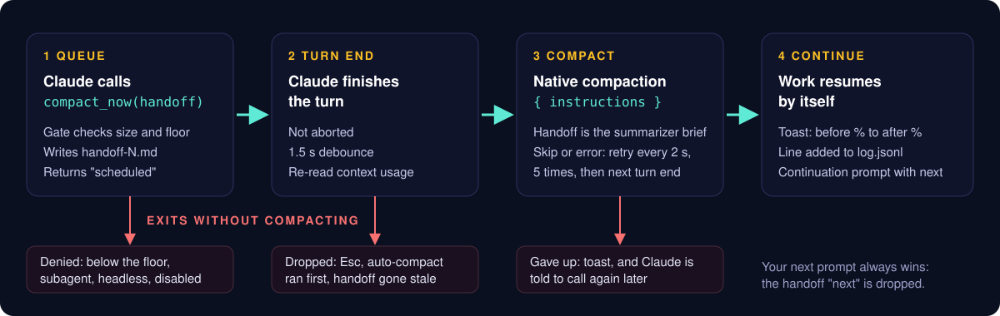

<div align="center">


# self-compact

**A Claude Code plugin that lets Claude compact its own context at task milestones: agent-initiated `/compact` with self-written instructions, then auto-continue.**

[Quick start](#quick-start) · [When it compacts](#when-it-compacts) · [Cost model](#cost-model) · [Docs](./docs/README.md) · English | [简体中文](./README.zh-cn.md)

[](#license)
[](https://github.com/w21180239/claude-code-self-compact/actions/workflows/ci.yml)
[](https://github.com/w21180239/claude-code-self-compact/stargazers)
[](#requirements)

</div>

self-compact gives Claude a `compact_now` tool. When Claude finishes a unit of work (a spec is written, a merge request is up, a task is handed to a background agent), it can request a compaction and write the handoff itself: your standing orders in your own words, the decisions and their reasons, what is still pending, and the first step after compaction. The plugin checks that compacting is worth it, runs the compaction after the turn ends, and sends a continuation prompt so work picks up without you typing anything.

## Why

Long sessions compact whether or not you plan for it. Auto-compact fires at an arbitrary moment, often mid-task, and the summarizer has to guess which parts of the conversation matter. A manual `/compact` with your own instructions works better, but only when you are there to pick the moment and write them.

This plugin moves that judgment to Claude, which knows where the task stands. It addresses two open feature requests: [anthropics/claude-code#19877](https://github.com/anthropics/claude-code/issues/19877) and [#96713](https://github.com/anthropics/claude-code/issues/96713) (let the model trigger compaction itself, at a good moment, instead of auto-compact firing at a random one).

The node and anti-node lists below were drawn from 214 manual compactions in the author's own history. Median context before compaction was 318k tokens on a 1M window, and about a third happened at 32-72% of the window in the middle of a task.

## How it works

<p align="center"></p>

1. Claude judges it is at a node and calls `mcp__self-compact__compact_now(handoff)`.
2. The gate checks context size. Too small: the call is denied with the current percentage and the floor. Otherwise the plugin writes `handoff-<n>.md`, queues the request and returns "scheduled". Claude ends the turn with one line.
3. After the main turn completes (not aborted), a 1.5 s debounce, then a re-check of usage and `$.session.compact({ instructions })` with Claude's handoff as the instructions. A skip or error retries every 2 s up to 5 times, then once more at the next turn end, then gives up with a toast and a note to Claude.
4. On success the plugin shows a toast (`A% -> B%`), logs the run and submits a continuation prompt: node, before and after, handoff path, `next`, standing orders and pending items verbatim.

Races are handled: a new prompt from you wins (compaction still runs, `next` is dropped), auto-compact running first drops the request, Esc drops it, and a handoff that goes stale after more than 3 further tool calls is dropped with a note to Claude. Details in [docs/en/DESIGN.md](./docs/en/DESIGN.md).

## Requirements

- Claude Code 2.1.287 or later (plugin mods are on by default from that version). Developed on 2.1.322.
- A 1M-token window is the target. See [Limitations](#limitations).

## Quick start

Inside Claude Code:

```text
/plugin marketplace add w21180239/claude-code-self-compact
/plugin install self-compact@claude-code-self-compact
```

Or from a shell:

```bash
claude plugin marketplace add w21180239/claude-code-self-compact
claude plugin install self-compact@claude-code-self-compact
```

Restart Claude Code or run `/reload-plugins`, then check it loaded. Ask Claude "what tools do you have for compaction?" and look for `mcp__self-compact__compact_now`. To test the gate early in a fresh session, ask Claude to call it: below the floor the call is denied with your current context percentage and the threshold.

After that there is nothing to run. Claude decides when to call the tool.

## When it compacts

Two layers. The plugin enforces a floor. Claude decides everything above it, guided by the tool description and by nudges.

The plugin refuses a call unless the tokens are at least `floorPct` of the window and at least `minSavingK` above the estimated post-compact size (session baseline + 20k). The baseline is the context size of the session's first main request, read only when the conversation has at most 3 messages (65k otherwise, for example on a resumed session). With the defaults and a 65k baseline the floor is 125k, or 12.5% of a 1M window; on a 200k window the same 125k is 62.5%, so the tool now opens there instead of staying shut.

| Context | Behavior |
| --- | --- |
| below 10% | denied by the plugin |
| 10-15% | big phase handoffs only (spec to plan, plan to implementation, MR up to review) |
| 15% and up | any clean node |
| 20% and up | nudge, then again every 5% |
| 35% and up | nudge wording escalates: compact at the next safe step |

Nudges ride on the next text tool result, or on the next prompt's context. They are silent while a request is queued or compacting, in subagents, in non-interactive sessions and when disabled.

### Nodes and anti-nodes

Good nodes:

- A block of work ends (push or merge verified, tests green, PR opened or merged, message sent, todos complete), with no agents running.
- State was just written to disk (handoff file, memory, skill) and pushed.
- You change topic, or pick the work up again after a pause.
- A phase handoff: spec or plan written, next step named, merge request created.
- A subagent returned, or work was delegated and Claude is now waiting, with every running task and its reporting route listed in `pending`.
- Finished work is saved to disk and handed to you for review or sign-off (a rendered page, a draft file), with what you are asked to look at listed in `pending`.
- You say "compact", "continue" or "next".

Anti-nodes, where Claude is told not to compact:

- A question is waiting for your answer and that answer decides the next step, or an outgoing draft is waiting for you to say send.
- You just corrected something or gave a new rule or permission that is not yet in the handoff.
- Mid polling, retrying, editing or a debug loop.
- The API just returned an error, or Claude is waiting for you to log in or dismiss a dialog.
- A background agent's result arrived and has not been read.

The plugin checks one of these itself: if the last tool call was `AskUserQuestion`, the request is denied.

### Autonomous triggers

The tool description alone does not make Claude compact: in a live session it finished a phase and moved on. The plugin therefore adds three triggers, so you never have to mention compaction:

- **Node flag.** After a `git push`, `git merge`, a PR/MR create, review or merge, a `git tag`, a message sent through `gog`, `agent-slack` or `outlook`, a spec/plan/handoff file write, or a todo list with every item completed, one line is attached to that tool result when the gate is open. Weaker signals (`git commit`, tests passed, a new `.md` file, a background agent launch, a subagent returning) are flagged only 5 points above the floor. At most one flag per turn.
- **Turn-end self-check.** After a turn that ends, the plugin submits one short prompt when a node was flagged, when the turn did real work (two or more main-session tool calls) and the context is near the nudge start, or when the context passed the nudge start without a compaction. Claude either calls `compact_now` or answers "skip". A turn ending in a question still asks, because completion summaries often end that way; only `AskUserQuestion` suppresses it. A check is limited to one per trigger per 5 points of growth and never repeats without new tool activity.
- **Block-start hint.** On every human prompt once the gate is open, a model-only line suggests compacting first when the message opens a new block of work (a different topic, or picking work up after a pause) and the previous block is closed.

`autoNodes` turns all three off; `turnEndCheck` turns off only the self-check. Compaction always resumes work: the continuation prompt is sent after every successful compaction.

## What the handoff keeps

`compact_now` takes a structured handoff: `node`, `objective`, `standing_orders` (your rules and permissions, in your words), `decisions` (with reasons), `artifacts`, `pending` (each running task and how it reports), `done`, `next`, and optional `drop` and `lessons` (what failed and why). A call missing a required field is denied and the field is named.

The plugin renders it to `handoff-<n>.md`, adds your original request (saved once per session, so it survives repeated compactions) and your last 5 real messages (commands, system reminders and task notifications are filtered out), and sends the result as the compact instructions. A preamble tells the summarizer to keep standing orders verbatim, list every pending item and end on `next`, to copy paths with line numbers, error strings, values and signatures exactly, and to drop stale logs, repeated reads and dead ends (keeping their lesson). Instructions are capped at 8,000 characters; `done` is trimmed first, then your oldest messages. `standing_orders`, `pending` and `next` are never trimmed.

After compaction the same standing orders and pending items arrive again, verbatim, in the continuation prompt, so they do not depend on how the summarizer paraphrased them. Claude can also re-read the full handoff file, and the continuation tells it to grep the session transcript when it needs an exact detail from before compaction.

## Cost model

A compaction costs tokens and time: it generates a summary and re-caches what remains. It pays off when enough calls follow at the smaller size.

Assumptions: relative to the input price, cache read is 0.1x, 1-hour cache write 2x and output 5x. The context left after a compaction is about 20k tokens (median over 83 compactions in the author's sessions). One compaction costs about `0.1 x C + 105k` input-equivalent tokens, where `C` is the context size before and 105k is a conservative fixed estimate for the summary and re-caching. Each later call saves `0.1 x (C - 20k)`.

| Context before | Cost of compacting | Saved per call | Break-even |
| --- | --- | --- | --- |
| 100k | 115k | 8k | about 14 calls |
| 150k | 120k | 13k | about 9 calls |
| 200k | 125k | 18k | about 7 calls |

A compaction leaves about 20k behind on the measured setup, so the saving per call is 0.1 x (context - 20k). The floor sits near 100k tokens on a 1M window (10%) and near 80k on a 200k window (baseline + 60k): below that, compacting early costs more than it saves. A compaction takes 30-55 seconds. These numbers are estimates; `log.jsonl` records before and after percentages so you can check them on your own sessions.

## Configuration

Set the options through the plugin settings (`userConfig` in `plugin.json`), for example with `claude plugin configure self-compact`.

| Option | Default | Meaning |
| --- | --- | --- |
| `language` | en | `en` or `zh`: language of the tool description, denials, toasts, nudges and continuation prompt; any other value falls back to `en` |
| `floorPct` | 10 | hard floor, percent of the window |
| `minSavingK` | 40 | the floor is also at least baseline + 20k + this many thousand tokens, so a small window still gets a worthwhile saving |
| `nudgeStartPct` | 20 | first nudge (raised to the floor when higher) |
| `nudgeStepPct` | 5 | gap between nudges |
| `urgentPct` | 35 | escalated nudge wording |
| `releaseStopHooks` | false | true: a queued compaction ends a turn that another Stop hook (such as /goal) holds open. Only works on personal (non-managed) setups; the built-in guard skips user mods' Stop hooks elsewhere (see FAQ) |
| `autoNodes` | true | Autonomous triggers: a one-line flag after node-like tool calls (push, merge, PR, tests green, message sent, spec/plan written, todos done), a turn-end self-check, and a hint on every human prompt once the gate is open. false turns all three off |
| `turnEndCheck` | true | The turn-end self-check only (needs `autoNodes`): after a node, a turn that did real work, or a long uncompacted stretch, one extra turn asks Claude whether to compact |
| `enabled` | true | false: the tool stays registered, every call is denied, no nudges |

`DISABLE_COMPACT=1` in the environment also denies every call. Handoff content (your standing orders, decisions) stays in whatever language you used; `language` only changes the plugin's own text.

## Data and privacy

Everything lives under `~/.claude/self-compact/`, never inside a repository:

- `<session-id>/handoff-<n>.md`: the rendered handoff plus your original request and last 5 real messages.
- `<session-id>/intent.md`: your first message in the session, capped at 1,500 characters.
- `log.jsonl` (rotated to `log.1.jsonl` at about 2 MB; an unreadable log is left untouched, never overwritten): one JSON line per request with `ts`, `session`, `node`, `pct` (usage at request), `result` (`queued`, `denied:<why>`, `done`, `preempted`, `aborted`, `stale`, `failed`, `error`), an optional `reason`, `beforePct`, `afterPct` and `durationMs`.

Nothing leaves your machine. The plugin makes no network calls and has no dependencies. The compaction itself is Claude Code's own `$.session.compact`, so the summary is produced by the same model and account as the rest of your session. Handoff files contain your own words from the conversation; delete the folder whenever you like.

## Limitations

- Built for 1M-token windows. The post-compact ratio rule puts the floor at about 77% of a 200k window, so on small windows the tool is effectively closed and auto-compact does the work.
- Main session only. Subagents are denied; keep them short and split them when they grow.
- Interactive sessions only. `claude -p`, SDK and cron sessions are denied and get no nudges.
- No typing detection. Mods cannot see your draft or keystrokes, so the plugin runs only when no turn is active, waits 1.5 s after the turn ends, and the continuation prompt waits for idle. A compaction can still land while you are about to type.
- `/goal`-style Stop hooks can hold a queued compaction until the next natural turn end unless `releaseStopHooks` is on (personal setups only).
- Compaction uses the native summarizer and takes 30-55 seconds.

## How it compares

| | self-compact | Native auto-compact | `/compact` by hand | [fast-jev-compaction](https://github.com/tamaratran/fast-jev-compaction) | [planning-with-files](https://github.com/OthmanAdi/planning-with-files) | Handoff skills |
| --- | --- | --- | --- | --- | --- | --- |
| Who picks the moment | Claude, at a node, above a floor | Claude Code, near the window limit | You | Whatever triggers compaction | n/a (re-injects after compaction) | You or Claude, by convention |
| Who writes the instructions | Claude, structured handoff | None (default prompt) | You | None; replaces the summary | n/a | Claude, free-form file |
| Continues by itself | Yes, continuation prompt | Native behavior | No | Native behavior | Re-reads plan files | Usually a manual new session |
| Needs an API key or network | No | No | No | Yes, an external scoring model | No | No |
| Enforced size gate | Yes | n/a | No | n/a | n/a | No |

How the others work, briefly. Native auto-compact summarizes when the window nears its limit. `/compact` runs the summarizer once with the instructions you give it. fast-jev-compaction replaces the compaction summary with the original messages minus tool calls and results that an external model scores as no longer needed. planning-with-files keeps plans and progress in files and re-injects them so context loss after compaction or `/clear` hurts less. Handoff skills write a summary file you can start a fresh session from. These approaches mostly address different parts of the problem and can be combined: for example, self-compact chooses when, and a plan file keeps long-lived state.

## FAQ and troubleshooting

**Claude says it has no compaction tool.** Restart Claude Code or run `/reload-plugins`, then run `/plugin` and check that `self-compact` is enabled. Check `claude --version` is 2.1.287 or later. Ask "what tools do you have for compaction?" and look for `mcp__self-compact__compact_now`.

**Every call is denied.** Read the denial text, which names the reason. Common ones: context below the threshold (the message shows your percentage and the threshold; on a 200k window the threshold is about 77%), a subagent or non-interactive session, the plugin disabled (`enabled` is false or `DISABLE_COMPACT=1`), or the last tool call was `AskUserQuestion`.

**Claude called it and nothing compacted.** Look at the last lines of `~/.claude/self-compact/log.jsonl` (see below) and read the `result` field. `preempted` means auto-compact ran first, `aborted` means you pressed Esc, `stale` means Claude made more than 3 further tool calls after queueing, `failed` means the compaction was skipped or errored through all retries.

**It compacted at a bad moment.** Raise `floorPct`, or open an issue with the `log.jsonl` line and what Claude was doing; the node and anti-node lists are tuned from reports like that.

**How do I read `log.jsonl`?** One JSON object per line. For example:

```bash
tail -n 5 ~/.claude/self-compact/log.jsonl
jq -c 'select(.result == "done")' ~/.claude/self-compact/log.jsonl
```

Compare `beforePct` and `afterPct` with the [cost model](#cost-model) to see whether your floor is right.

**Every turn ends with "self-compact: its classic.Stop hook was skipped".** Where Claude Code's built-in guard `sec-default@builtin` (shown as `cc-plugin-sec-default`) loads, hooks a user's mod registers on `classic.<Event>` never run, and Claude Code warns at each turn end. The guard loads on any Team/Enterprise `/login` session and on machines with managed settings, and users cannot turn it off ([admin docs](https://code.claude.com/docs/en/plugins/mods/admin.md)). `releaseStopHooks` is off by default for this reason; the option only helps on personal (non-managed) setups, and leaving it off removes the warning.

**I want it off.** Set `enabled` to false, or export `DISABLE_COMPACT=1`. Auto-compact and `/compact` are unaffected.

## Uninstall

```bash
claude plugin uninstall self-compact@claude-code-self-compact
claude plugin marketplace remove claude-code-self-compact
```

The plugin changes no settings files. To delete its data, remove `~/.claude/self-compact/`.

## Development

The plugin lives in `plugins/self-compact/` (`hooks/register.ts`, `tests/self-compact.test.ts`). With the `claude` CLI installed:

```bash
claude plugin validate .
claude plugin validate plugins/self-compact
claude plugin test plugins/self-compact
```

CI runs the same commands on Ubuntu and macOS. See [CONTRIBUTING.md](./CONTRIBUTING.md) and [AGENTS.md](./AGENTS.md). Design notes: [docs/en/DESIGN.md](./docs/en/DESIGN.md). Changes: [docs/en/CHANGELOG.md](./docs/en/CHANGELOG.md).

## License

Dual-licensed under [MIT](./LICENSE-MIT) or [Apache-2.0](./LICENSE-APACHE), at your option.
