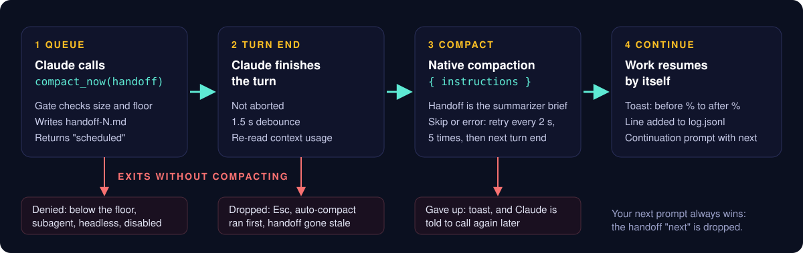

<div align="center">


# self-compact

**一个 Claude Code 插件：让 Claude 在任务节点上自己 compact 上下文。由 Claude 发起 `/compact`、自己写压缩指令，压完自动接着干。**

[快速开始](#快速开始) · [何时压缩](#何时压缩) · [成本模型](#成本模型) · [文档](./docs/README.md) · [English](./README.md) | 简体中文

[](#许可)
[](https://github.com/w21180239/claude-code-self-compact/actions/workflows/ci.yml)
[](https://github.com/w21180239/claude-code-self-compact/stargazers)
[](#环境要求)

</div>

self-compact 给 Claude 一个 `compact_now` 工具。Claude 做完一个工作单元（spec 写完、MR 建好、任务交给后台 agent）时，可以请求一次压缩，并自己写交接单：你的常驻规则（用你的原话）、已定决定和原因、还没做完的事、压缩后的第一步。插件负责执行上下文门槛（回本下限），并在本轮结束后执行压缩；过了门槛后，现在压是否划算由 Claude 自己判断。压完再发一条续接消息，不用你动手工作就能接上。

## 为什么需要

长会话迟早要压缩。auto-compact 在任意时刻触发，常常压在任务中间，summarizer 只能猜哪些内容重要。你手动 `/compact` 并写好指令效果更好，但前提是你在场，能选时机、写指令。

这个插件把判断交给最清楚任务进度的 Claude。它对应 Claude Code 里两个未解决的功能请求：[anthropics/claude-code#19877](https://github.com/anthropics/claude-code/issues/19877) 和 [#96713](https://github.com/anthropics/claude-code/issues/96713)（让模型自己在合适的时机触发 compact，替代 auto-compact 在随机时刻触发）。

下文的节点与反节点清单，来自作者自己的 214 次手动压缩记录：1M 窗口下，压缩前上下文中位数 318k tokens，约三分之一是在窗口用到 32-72% 时、任务中途压的。

## 工作原理

<p align="center"></p>

1. Claude 判断到了节点，调用 `mcp__self-compact__compact_now(handoff)`。
2. 门槛检查上下文大小。太小则拒绝，并告知当前占比和门槛；否则插件写入 `handoff-<n>.md`、排队，返回"已排队"。Claude 用一句话结束本轮。
3. 主轮结束（未被中断）后，防抖 1.5 秒，再读一次用量，调用 `$.session.compact({ instructions })`，指令就是 Claude 写的交接单。跳过或出错则每 2 秒重试，最多 5 次，之后在下一个主轮结束时再试一次，仍失败就放弃，弹 toast 并告知 Claude。
4. 成功后插件弹 toast（`A% -> B%`）、记日志，并提交续接消息：节点、压缩前后占比、交接单路径、`next`、常驻规则和待处理项原文。

竞态都有处理：你发了新消息则以你为准（仍会压缩，但丢弃 `next`）；auto-compact 抢先则丢弃请求；Esc 丢弃请求；排队后 Claude 又调了超过 3 次工具，交接单视为过期，丢弃并告知 Claude。细节见 [docs/zh-cn/DESIGN.md](./docs/zh-cn/DESIGN.md)。

## 环境要求

- Claude Code 2.1.287 或更高（plugin mods 从该版本起默认开启），开发于 2.1.322。
- 面向 1M token 窗口，见[已知限制](#已知限制)。

## 快速开始

在 Claude Code 里：

```text
/plugin marketplace add w21180239/claude-code-self-compact
/plugin install self-compact@claude-code-self-compact
```

或在 shell 里：

```bash
claude plugin marketplace add w21180239/claude-code-self-compact
claude plugin install self-compact@claude-code-self-compact
```

重启 Claude Code 或运行 `/reload-plugins`，然后确认已加载：问 Claude "你有哪些压缩相关的工具？"，应当看到 `mcp__self-compact__compact_now`。想提前测试门槛，可以在新会话里让 Claude 调用一次：低于下限时调用会被拒绝，并附上当前上下文占比和门槛。

之后无需任何操作，什么时候调用由 Claude 决定。

## 何时压缩

分两层：插件强制一个下限，下限之上由 Claude 判断，依据是工具描述和插件的提醒。

插件的所有门槛都由 P（学到的压后大小，见[成本模型](#成本模型)）推出。低于下限 `max(C(floorCalls), floorPct x window)` 时拒绝调用，其中 `C(floorCalls)` 是压缩后 20 次调用内回本的大小。P = 87k 时下限为 147k；环境偏重时随 P 上升。各档都被紧急档 `min(urgentK x 1k, 窗口的 80%)` 截顶，所以小窗口也能打开工具。随后每一档都至少抬到 `P + 25k`，保证一次压缩至少释放 25k，压完不会立刻再触发某一档。

| 上下文大小 | 行为 |
| --- | --- |
| 低于下限（`C(20)`） | 插件拒绝 |
| 下限到节点档（`C(10)`） | 只在大阶段交接时压（spec 到 plan、plan 到实现、MR 建好到 review） |
| 节点档（`C(10)`）及以上 | 任何干净节点都可以压 |
| 节点档起，之后每涨 5% | 提醒 |
| 紧急档（350k 或窗口的 80%）及以上 | 提醒措辞升级：在下一个安全步骤压 |

提醒附在下一个文本形态的工具结果上，或下一个 prompt 的上下文里。有排队请求或正在压缩时、subagent 中、非交互会话中、插件关闭时都不提醒。

### 节点与反节点

好节点：

- 一整块工作收尾（push 或合并已验证、测试通过、PR 已开或已合、消息已发、待办全完成），且没有在跑的 agent。
- 状态刚落盘（交接文件、memory、skill 已写并 push）。
- 你换了话题，或隔了一阵重新接着做。
- 阶段交接：spec 或 plan 已写完、下一步已点名、MR 已创建。
- 子代理返回，或任务委派出去后 Claude 进入等待，且 `pending` 里列出了每个在跑的任务和它的回报方式。
- 成果已落盘、交给你审阅或确认（例如渲染好的页面、写好的草稿文件），`pending` 写明在等你看什么。
- 你说了"compact"、"继续"或"下一个"。

反节点，告诉 Claude 不要压：

- 有个问题等你回答，而且你的答案决定下一步怎么做；或外发草稿在等你说"发"。
- 你刚纠正了什么，或给了新规则、新授权，还没写进交接单。
- 轮询、重试、编辑、调试循环中间。
- API 刚报错，或 Claude 在等你登录、处理弹窗。
- 后台 agent 的结果已到但还没读。

其中一项由插件自己检查：如果最后一次工具调用是 `AskUserQuestion`，请求会被拒绝。

### 自主触发

只靠工具描述，Claude 不会主动压缩：实测中它做完一个阶段就直接往下走了。因此插件加了三个触发点，用户无需再提压缩：

- **节点标记。** 出现 `git push`、`git merge`、PR/MR 创建（含评审、评论、关闭）或合并、`git tag`、通过 `gog`、`agent-slack`、`outlook` 发出消息、写入 spec/plan/handoff 文件，或待办全部完成时，若门槛已开，就在该工具结果后附一行。较弱的信号（`git commit`、测试通过、新建 `.md`、后台 agent 启动、子代理返回）要高出下限 5 个百分点才标记。每个回合最多一条。
- **回合末自检。** 每个回合结束时，以下任一情况插件会提交一条简短 prompt：出现过节点标记、这一轮做了实活（主会话至少 2 次工具调用）且接近提醒起点、或上下文越过提醒起点仍未压缩。过线只是必要条件：当前块已收尾、接下来的工作不依赖上下文里的大段原文、剩余工作还够长，三条都满足 Claude 才调用 `compact_now`，否则回复 `skip: <一句理由>`，理由会记在日志 `self-check:declined` 行的 `reason` 里。回合以提问结束也会自检，因为收尾总结常常带问句；只有 `AskUserQuestion` 会抑制自检。每个触发点每涨 5 个百分点最多自检一次，没有新的工具活动不会连续自检。
- **新工作块提示。** 门槛只要已开，每个人工 prompt 都会带一行：如果这条消息开启新工作块（换话题，或停了一阵重新接着做），而上一块已经收尾，先压缩再做。

`autoNodes` 同时关闭这三项；`turnEndCheck` 只关闭回合末自检。压缩之后一律续接：每次成功压缩都会发送续接 prompt。

## 交接单保留什么

`compact_now` 接收结构化的交接单：`node`、`objective`、`standing_orders`（你的规则和授权，用你的原话）、`decisions`（含原因）、`artifacts`、`pending`（每个在跑的任务及回报方式）、`done`、`next`，以及可选的 `drop` 和 `lessons`（试过不行的做法及原因）。缺必填字段时调用被拒绝，并指出缺哪一项。

插件把它渲染成 `handoff-<n>.md`，附上你最初的需求（每个会话只存一次，多次压缩也不会走样）和最近 5 条真实消息（过滤掉命令、系统提醒、任务通知），再作为压缩指令发出。前面的固定前言要求 summarizer 原样保留常驻规则、列全待处理项、以 `next` 收尾；带行号的路径、报错原文、数值和签名原样照抄；过时的日志、重复读取和走不通的路可以丢，但留下教训。指令总长上限 8,000 字符，超出时先截 `done`，再截你最早的消息；`standing_orders`、`pending`、`next` 永远不截。

压缩之后，同样的常驻规则和待处理项会再通过续接消息原文送回，不依赖 summarizer 怎么转述。Claude 也可以回读完整的交接文件；续接消息还会告诉它，需要压缩前的确切细节时去 grep 本会话的 transcript。

## 成本模型

压缩要花 token 和时间：要生成摘要，还要重新缓存剩下的内容。只有压缩之后还有足够多的调用跑在更小的上下文上，才划算。

假设：相对输入单价，cache read 0.1 倍、1 小时 cache write 2 倍、output 5 倍。一次压缩约花 `F + 0.1 x C`（输入 token 当量），`F` 即 `compactCostK`（默认 105k，生成摘要加重新缓存的保守固定估计），`0.1 x C` 是读被压缩上下文的 cache read。不压缩则之后每次调用多花 `0.1 x (C - P)`，`C` 是当前上下文，`P` 是压后大小。在 `C` 处压缩，`N` 次调用内回本的条件是 `N x 0.1 x (C - P) >= F + 0.1 x C`，即 `C(N) = (10 x F + N x P) / (N - 1)`。

| P（压后大小） | C(8) | C(10) | C(20) |
| --- | --- | --- | --- |
| 65k | 224k | 189k | 124k |
| 87k | 249k | 213k | 147k |
| 120k | 287k | 250k | 182k |

P 的来源：每次压缩后的第一个主轮请求是压后大小的真实测量，按项目和全局各存一份指数加权平均（alpha 0.3），保存在 `~/.claude/self-compact/profile.json`。与均值相差超过 50% 的样本视为离群点，影响更小（alpha 0.1）；同方向连续 3 个离群点则把均值重置为它们的平均。累计 3 个样本后才被信任。在此之前 P 按顺序回退：本会话样本、项目估计、全局估计、会话基线 + 25k（基线未知时取 65k，即 P = 90k）。`log.jsonl` 的 `afterPct` 是压缩上报的大小，也就是摘要；`pSample` 才是压后第一个真实请求测得的大小。

重型环境（MCP 或 skill 定义很大）P 很大，压缩收益有限。当 `C(workCalls)` 达到 `urgentK` 时，插件每个会话提示一次 Claude：环境偏重，建议精简 MCP 服务或 skill。一次压缩耗时 30-55 秒。这些数字是估计值，`log.jsonl` 记录了各项大小，你可以用自己的会话验证。

## 配置

通过插件设置修改（`plugin.json` 里的 `userConfig`），例如 `claude plugin configure self-compact`。

| 选项 | 默认 | 含义 |
| --- | --- | --- |
| `language` | en | `en` 或 `zh`：工具描述、拒绝信息、toast、提醒和续接消息的语言；其他值回退为 `en` |
| `floorPct` | 0 | 额外下限，窗口百分比；下限取它与 `floorCalls` 对应大小中的较大者 |
| `floorCalls` | 20 | 下限 = 压缩后该调用数内回本所需的上下文大小（见[成本模型](#成本模型)），至少 2 |
| `nodeCalls` | 10 | 节点档：达到该调用数内回本的大小后，任何干净节点都可压缩 |
| `workCalls` | 8 | 实活档：回合末自检从该回本大小起把一段实活视为节点 |
| `urgentK` | 350 | 紧急档，单位千 tokens，上限为窗口的 80%；其余各档都被它截顶（最小 50），再抬到至少 P + 25k |
| `compactCostK` | 105 | 一次压缩的固定成本，单位千 tokens（摘要加重新缓存），最小 1 |
| `nudgeStepPct` | 5 | 提醒间隔 |
| `releaseStopHooks` | false | true 时，排队中的压缩可以结束被其他 Stop hook（如 /goal）撑住的回合。仅在个人（非托管）环境有效；其他环境下内置 guard 会跳过用户 mod 的 Stop hook（见 FAQ） |
| `autoNodes` | true | 自主触发：节点类工具调用（push、merge、PR、测试通过、消息已发、spec/plan 落盘、待办全完成）后附一行标记，回合末自检，门槛已开时每个人工 prompt 带新工作块提示。false 同时关闭这三项 |
| `turnEndCheck` | true | 仅回合末自检（依赖 `autoNodes`）：出现节点、回合做了实活或长时间未压缩后，多开一个回合问 Claude 是否压缩 |
| `enabled` | true | false 时工具仍注册，但所有调用被拒绝，也不提醒 |

旧键 `minSavingK`、`nudgeStartPct`、`urgentPct` 仍可传入，但会被忽略；会话开始时插件写一行日志提示。请从设置中删除。

环境变量 `DISABLE_COMPACT=1` 同样让所有调用被拒绝。交接单内容（你的常驻规则、决定）保持你使用的语言；`language` 只改变插件自己的文字。

## 数据与隐私

所有数据都在 `~/.claude/self-compact/` 下，不进任何仓库：

- `<session-id>/handoff-<n>.md`：渲染后的交接单，加上你最初的需求和最近 5 条真实消息。
- `<session-id>/intent.md`：你在本会话的第一条消息，上限 1,500 字符。
- `profile.json`：学到的压后大小 P，按项目（以 cwd 绝对路径为键）和全局各一份，附样本数。
- `log.jsonl`：每次请求一行 JSON，字段有 `ts`、`session`、`node`、`pct`（请求时占比）、`result`（`queued`、`denied:<原因>`、`done`、`preempted`、`aborted`、`stale`、`failed`、`error`、`p-sample`、`deprecated`、`tool-describe`）、可选的 `reason`、`beforePct`、`afterPct`、`durationMs`、`pSample`（压后实测大小）、`p`（当时采用的 P）。

数据不会离开你的机器。插件不发起网络请求，也没有依赖。压缩本身用的是 Claude Code 自带的 `$.session.compact`，所以摘要由你这次会话所用的同一个模型和账号生成。交接文件里是你在对话中的原话，想删随时可以删这个目录。

## 已知限制

- 面向 1M token 窗口。压后比例规则让下限在 200k 窗口下约为 77%，小窗口里这个工具基本关闭，由 auto-compact 负责。
- 压后体积大、窗口小时，各档位可能超过窗口的 80%（每档都至少是 P + 25k，保证压一次总能腾出空间），此时引擎的自动压缩可能先触发。
- 只管主会话。subagent 调用会被拒绝；让 subagent 保持短小，超了就拆。
- 只在交互会话中可用。`claude -p`、SDK、定时任务会被拒绝，也不会收到提醒。
- 没有输入检测。mods 看不到你的草稿或按键，所以插件只在没有轮次运行时执行，轮次结束后再等 1.5 秒，续接消息也等空闲后才发。压缩仍可能落在你正要打字的时候。
- `/goal` 这类 Stop hook 可能让排队的压缩等到下一个自然回合结束，除非开启 `releaseStopHooks`（仅个人环境）。
- 压缩用原生 summarizer，耗时 30-55 秒。

## 对比

| | self-compact | 原生 auto-compact | 手动 `/compact` | [fast-jev-compaction](https://github.com/tamaratran/fast-jev-compaction) | [planning-with-files](https://github.com/OthmanAdi/planning-with-files) | 交接类 skill |
| --- | --- | --- | --- | --- | --- | --- |
| 谁选时机 | Claude，在节点上，且高于下限 | Claude Code，接近窗口上限时 | 你 | 任何触发压缩的时刻 | 不适用（压缩后重新注入） | 你或 Claude，靠约定 |
| 谁写指令 | Claude，结构化交接单 | 无（默认提示词） | 你 | 无；直接替换摘要 | 不适用 | Claude，自由格式文件 |
| 自动续接 | 是，续接消息 | 原生行为 | 否 | 原生行为 | 重新读取 plan 文件 | 通常手动开新会话 |
| 需要 API key 或联网 | 否 | 否 | 否 | 是，外部打分模型 | 否 | 否 |
| 强制大小门槛 | 是 | 不适用 | 否 | 不适用 | 不适用 | 否 |

简要说明其他方案的做法。原生 auto-compact 在窗口接近上限时生成摘要。`/compact` 按你给的指令运行一次 summarizer。fast-jev-compaction 把压缩摘要替换成原始消息，仅去掉外部模型判定为不再需要的工具调用和结果。planning-with-files 把计划和进度存在文件里并重新注入，让压缩或 `/clear` 之后的损失更小。交接类 skill 写一份摘要文件，供你用新会话接着做。这些方案解决的是问题的不同部分，可以组合使用：比如 self-compact 决定什么时候压，plan 文件保存长期状态。

## 常见问题与排查

**Claude 说没有压缩工具。** 重启 Claude Code 或运行 `/reload-plugins`，再运行 `/plugin` 确认 `self-compact` 已启用，并检查 `claude --version` 不低于 2.1.287。问"你有哪些压缩相关的工具？"，应当看到 `mcp__self-compact__compact_now`。

**每次调用都被拒绝。** 看拒绝信息，里面写明了原因。常见的有：上下文低于门槛（信息里有你的占比和门槛；200k 窗口下门槛约为 77%）、subagent 或非交互会话、插件被关闭（`enabled` 为 false 或 `DISABLE_COMPACT=1`），或最后一次工具调用是 `AskUserQuestion`。

**Claude 调用了但没有压缩。** 看 `~/.claude/self-compact/log.jsonl` 的最后几行（见下），读 `result` 字段。`preempted` 表示 auto-compact 抢先了，`aborted` 表示你按了 Esc，`stale` 表示排队后 Claude 又调了超过 3 次工具，`failed` 表示所有重试里压缩都被跳过或报错。

**它压在了不合适的时刻。** 调高 `floorPct`，或者提 issue，附上那一行 `log.jsonl` 和 Claude 当时在做什么；节点与反节点清单就是根据这类反馈调的。

**怎么看 `log.jsonl`？** 每行一个 JSON 对象，例如：

```bash
tail -n 5 ~/.claude/self-compact/log.jsonl
jq -c 'select(.result == "done")' ~/.claude/self-compact/log.jsonl
```

对照 `beforePct` 和 `afterPct` 与[成本模型](#成本模型)，可以判断你的下限设得是否合适。

**每个回合结束都提示 "self-compact: its classic.Stop hook was skipped"。** 在加载 Claude Code 内置 guard `sec-default@builtin`（显示为 `cc-plugin-sec-default`）的环境中，用户 mod 注册在 `classic.<Event>` 上的 hook 不会运行，Claude Code 每个回合结束都会警告。任何 Team/Enterprise `/login` 会话以及带托管设置的机器都会加载该 guard，用户无法关闭（[管理员文档](https://code.claude.com/docs/en/plugins/mods/admin.md)）。因此 `releaseStopHooks` 默认关闭；该选项只在个人（非托管）环境有效，保持关闭即可消除警告。

**我想关掉它。** 把 `enabled` 设为 false，或 `export DISABLE_COMPACT=1`。auto-compact 和 `/compact` 不受影响。

## 卸载

```bash
claude plugin uninstall self-compact@claude-code-self-compact
claude plugin marketplace remove claude-code-self-compact
```

插件不修改任何设置文件。要删除它的数据，删掉 `~/.claude/self-compact/`。

## 开发

插件位于 `plugins/self-compact/`（`hooks/register.ts`、`tests/self-compact.test.ts`）。装好 `claude` CLI 后：

```bash
claude plugin validate .
claude plugin validate plugins/self-compact
claude plugin test plugins/self-compact
```

CI 在 Ubuntu 和 macOS 上运行同样的命令。见 [CONTRIBUTING.md](./CONTRIBUTING.md) 和 [AGENTS.md](./AGENTS.md)。设计说明：[docs/zh-cn/DESIGN.md](./docs/zh-cn/DESIGN.md)。变更记录：[docs/en/CHANGELOG.md](./docs/en/CHANGELOG.md)。

## 许可

以 [MIT](./LICENSE-MIT) 或 [Apache-2.0](./LICENSE-APACHE) 双许可发布，任选其一。
