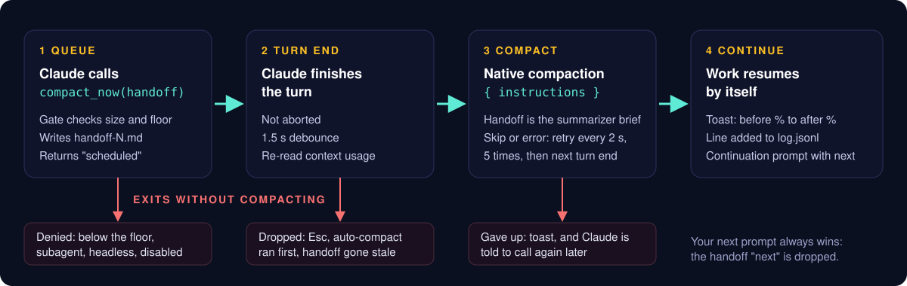

<div align="center">


# self-compact

**一个 Claude Code 插件：让 Claude 在任务节点上自己 compact 上下文。由 Claude 发起 `/compact`、自己写压缩指令，压完自动接着干。**

[快速开始](#快速开始) · [何时压缩](#何时压缩) · [成本模型](#成本模型) · [文档](./docs/README.md) · [English](./README.md) | 简体中文

[](#许可)
[](https://github.com/w21180239/claude-code-self-compact/actions/workflows/ci.yml)
[](https://github.com/w21180239/claude-code-self-compact/stargazers)
[](#环境要求)

</div>

self-compact 给 Claude 一个 `compact_now` 工具。Claude 做完一个工作单元（spec 写完、MR 建好、任务交给后台 agent）时，可以请求一次压缩，并自己写交接单：你的常驻规则（用你的原话）、已定决定和原因、还没做完的事、压缩后的第一步。插件负责检查现在压是否划算，在本轮结束后执行压缩，再发一条续接消息，不用你动手工作就能接上。

## 为什么需要

长会话迟早要压缩。auto-compact 在任意时刻触发，常常压在任务中间，summarizer 只能猜哪些内容重要。你手动 `/compact` 并写好指令效果更好，但前提是你在场，能选时机、写指令。

这个插件把判断交给最清楚任务进度的 Claude。它对应 Claude Code 里两个未解决的功能请求：[anthropics/claude-code#19877](https://github.com/anthropics/claude-code/issues/19877) 和 [#96713](https://github.com/anthropics/claude-code/issues/96713)（让模型自己在合适的时机触发 compact，替代 auto-compact 在随机时刻触发）。

下文的节点与反节点清单，来自作者自己的 214 次手动压缩记录：1M 窗口下，压缩前上下文中位数 318k tokens，约三分之一是在窗口用到 32-72% 时、任务中途压的。

## 工作原理

<p align="center"></p>

1. Claude 判断到了节点，调用 `mcp__self-compact__compact_now(handoff)`。
2. 门槛检查上下文大小。太小则拒绝，并告知当前占比和门槛；否则插件写入 `handoff-<n>.md`、排队，返回"已排队"。Claude 用一句话结束本轮。
3. 主轮结束（未被中断）后，防抖 1.5 秒，再读一次用量，调用 `$.session.compact({ instructions })`，指令就是 Claude 写的交接单。跳过或出错则每 2 秒重试，最多 5 次，之后在下一个主轮结束时再试一次，仍失败就放弃，弹 toast 并告知 Claude。
4. 成功后插件弹 toast（`A% -> B%`）、记日志，并提交续接消息：节点、压缩前后占比、交接单路径、`next`、常驻规则和待处理项原文。

竞态都有处理：你发了新消息则以你为准（仍会压缩，但丢弃 `next`）；auto-compact 抢先则丢弃请求；Esc 丢弃请求；排队后 Claude 又调了超过 3 次工具，交接单视为过期，丢弃并告知 Claude。细节见 [docs/zh-cn/DESIGN.md](./docs/zh-cn/DESIGN.md)。

## 环境要求

- Claude Code 2.1.287 或更高（plugin mods 从该版本起默认开启），开发于 2.1.322。
- 面向 1M token 窗口，见[已知限制](#已知限制)。

## 快速开始

在 Claude Code 里：

```text
/plugin marketplace add w21180239/claude-code-self-compact
/plugin install self-compact@claude-code-self-compact
```

或在 shell 里：

```bash
claude plugin marketplace add w21180239/claude-code-self-compact
claude plugin install self-compact@claude-code-self-compact
```

重启 Claude Code 或运行 `/reload-plugins`，然后确认已加载：问 Claude "你有哪些压缩相关的工具？"，应当看到 `mcp__self-compact__compact_now`。想提前测试门槛，可以在新会话里让 Claude 调用一次：低于下限时调用会被拒绝，并附上当前上下文占比和门槛。

之后无需任何操作，什么时候调用由 Claude 决定。

## 何时压缩

分两层：插件强制一个下限，下限之上由 Claude 判断，依据是工具描述和插件的提醒。

插件会拒绝调用，除非同时满足：token 数不低于窗口的 `floorPct`，且预计压后大小（本会话基线 + 20k）不超过当前大小的 `maxPostRatio`。基线取本会话首个主轮请求的上下文大小，拿不到时用 65k。

| 上下文占比 | 行为 |
| --- | --- |
| 低于 15% | 插件拒绝 |
| 15-20% | 只在大阶段交接时压（spec 到 plan、plan 到实现、MR 建好到 review） |
| 20% 及以上 | 任何干净节点都可以压 |
| 30% 及以上 | 提醒，之后每涨 5% 再提醒一次 |
| 40% 及以上 | 提醒措辞升级：在下一个安全步骤压 |

提醒附在下一个文本形态的工具结果上，或下一个 prompt 的上下文里。有排队请求或正在压缩时、subagent 中、非交互会话中、插件关闭时都不提醒。

### 节点与反节点

好节点：

- 一个工作单元结束、新需求开始（commit 和 push 已验证、合并已确认、消息已发、ticket 已更新），且没有在跑的 agent。
- 状态刚落盘（交接文件、memory、skill 已写并 push）。
- 你换了话题。
- 阶段交接：spec 或 plan 已写完、下一步已点名、MR 已创建。
- 任务委派出去、Claude 进入等待，且 `pending` 里列出了每个在跑的任务和它的回报方式。
- 你说了"compact"、"继续"或"下一个"。

反节点，告诉 Claude 不要压：

- 有问题在等你回答，或草稿在等你说"发"。
- 你刚纠正了什么，或给了新规则、新授权，还没写进交接单。
- 轮询、重试、编辑、调试循环中间。
- API 刚报错，或 Claude 在等你登录、处理弹窗。
- 后台 agent 的结果已到但还没读。

其中一项由插件自己检查：如果最后一次工具调用是 `AskUserQuestion`，请求会被拒绝。

## 交接单保留什么

`compact_now` 接收结构化的交接单：`node`、`objective`、`standing_orders`（你的规则和授权，用你的原话）、`decisions`（含原因）、`artifacts`、`pending`（每个在跑的任务及回报方式）、`done`、`next`，以及可选的 `drop`。缺必填字段时调用被拒绝，并指出缺哪一项。

插件把它渲染成 `handoff-<n>.md`，附上你最近 5 条真实消息（过滤掉命令、系统提醒、任务通知），再作为压缩指令发出，前面加一段固定前言：要求 summarizer 原样保留常驻规则、列全待处理项、以 `next` 收尾。指令总长上限 8,000 字符，超出时先截 `done`，再截你最早的消息；`standing_orders`、`pending`、`next` 永远不截。

压缩之后，同样的常驻规则和待处理项会再通过续接消息原文送回，不依赖 summarizer 怎么转述。Claude 也可以回读完整的交接文件。

## 成本模型

压缩要花 token 和时间：要生成摘要，还要重新缓存剩下的内容。只有压缩之后还有足够多的调用跑在更小的上下文上，才划算。

假设：相对输入单价，cache read 0.1 倍、1 小时 cache write 2 倍、output 5 倍。压缩后剩余约 80k tokens（作者本机会话的中位数实测）。一次压缩的成本约为 `0.1 x C + 105k` 输入当量，`C` 是压缩前上下文大小，105k 是生成摘要加重新缓存剩余部分的估计值。之后每次调用节省 `0.1 x (C - 80k)`。

| 压缩前上下文 | 压缩成本 | 每次调用节省 | 回本所需 |
| --- | --- | --- | --- |
| 150k | 120k | 7k | 约 17 次调用 |
| 200k | 125k | 12k | 约 10 次调用 |
| 300k | 135k | 22k | 约 6 次调用 |

所以下限定在 150k tokens 附近，压得太早或太频繁是净亏损。在测量的环境里，一次压缩耗时 30-55 秒。这些数字是估计值，`log.jsonl` 记录了压缩前后占比，你可以用自己的会话验证。

## 配置

通过插件设置修改（`plugin.json` 里的 `userConfig`），例如 `claude plugin configure self-compact`。

| 选项 | 默认 | 含义 |
| --- | --- | --- |
| `language` | en | `en` 或 `zh`：工具描述、拒绝信息、toast、提醒和续接消息的语言；其他值回退为 `en` |
| `floorPct` | 15 | 硬下限，窗口百分比 |
| `maxPostRatio` | 0.55 | 预计压后大小与当前大小之比的上限 |
| `nudgeStartPct` | 30 | 开始提醒（高于下限时取下限） |
| `nudgeStepPct` | 5 | 两次提醒的间隔 |
| `urgentPct` | 40 | 提醒措辞升级 |
| `releaseStopHooks` | false | true 时，排队中的压缩可以结束被其他 Stop hook（如 /goal）撑住的回合。仅在个人（非托管）环境有效；其他环境下内置 guard 会跳过用户 mod 的 Stop hook（见 FAQ） |
| `enabled` | true | false 时工具仍注册，但所有调用被拒绝，也不提醒 |

环境变量 `DISABLE_COMPACT=1` 同样让所有调用被拒绝。交接单内容（你的常驻规则、决定）保持你使用的语言；`language` 只改变插件自己的文字。

## 数据与隐私

所有数据都在 `~/.claude/self-compact/` 下，不进任何仓库：

- `<session-id>/handoff-<n>.md`：渲染后的交接单，加上你最近 5 条真实消息。
- `log.jsonl`：每次请求一行 JSON，字段有 `ts`、`session`、`node`、`pct`（请求时占比）、`result`（`queued`、`denied:<原因>`、`done`、`preempted`、`aborted`、`stale`、`failed`、`error`）、可选的 `reason`、`beforePct`、`afterPct`、`durationMs`。

数据不会离开你的机器。插件不发起网络请求，也没有依赖。压缩本身用的是 Claude Code 自带的 `$.session.compact`，所以摘要由你这次会话所用的同一个模型和账号生成。交接文件里是你在对话中的原话，想删随时可以删这个目录。

## 已知限制

- 面向 1M token 窗口。压后比例规则让下限在 200k 窗口下约为 77%，小窗口里这个工具基本关闭，由 auto-compact 负责。
- 只管主会话。subagent 调用会被拒绝；让 subagent 保持短小，超了就拆。
- 只在交互会话中可用。`claude -p`、SDK、定时任务会被拒绝，也不会收到提醒。
- 没有输入检测。mods 看不到你的草稿或按键，所以插件只在没有轮次运行时执行，轮次结束后再等 1.5 秒，续接消息也等空闲后才发。压缩仍可能落在你正要打字的时候。
- `/goal` 这类 Stop hook 可能让排队的压缩等到下一个自然回合结束，除非开启 `releaseStopHooks`（仅个人环境）。
- 压缩用原生 summarizer，耗时 30-55 秒。

## 对比

| | self-compact | 原生 auto-compact | 手动 `/compact` | [fast-jev-compaction](https://github.com/tamaratran/fast-jev-compaction) | [planning-with-files](https://github.com/OthmanAdi/planning-with-files) | 交接类 skill |
| --- | --- | --- | --- | --- | --- | --- |
| 谁选时机 | Claude，在节点上，且高于下限 | Claude Code，接近窗口上限时 | 你 | 任何触发压缩的时刻 | 不适用（压缩后重新注入） | 你或 Claude，靠约定 |
| 谁写指令 | Claude，结构化交接单 | 无（默认提示词） | 你 | 无；直接替换摘要 | 不适用 | Claude，自由格式文件 |
| 自动续接 | 是，续接消息 | 原生行为 | 否 | 原生行为 | 重新读取 plan 文件 | 通常手动开新会话 |
| 需要 API key 或联网 | 否 | 否 | 否 | 是，外部打分模型 | 否 | 否 |
| 强制大小门槛 | 是 | 不适用 | 否 | 不适用 | 不适用 | 否 |

简要说明其他方案的做法。原生 auto-compact 在窗口接近上限时生成摘要。`/compact` 按你给的指令运行一次 summarizer。fast-jev-compaction 把压缩摘要替换成原始消息，仅去掉外部模型判定为不再需要的工具调用和结果。planning-with-files 把计划和进度存在文件里并重新注入，让压缩或 `/clear` 之后的损失更小。交接类 skill 写一份摘要文件，供你用新会话接着做。这些方案解决的是问题的不同部分，可以组合使用：比如 self-compact 决定什么时候压，plan 文件保存长期状态。

## 常见问题与排查

**Claude 说没有压缩工具。** 重启 Claude Code 或运行 `/reload-plugins`，再运行 `/plugin` 确认 `self-compact` 已启用，并检查 `claude --version` 不低于 2.1.287。问"你有哪些压缩相关的工具？"，应当看到 `mcp__self-compact__compact_now`。

**每次调用都被拒绝。** 看拒绝信息，里面写明了原因。常见的有：上下文低于门槛（信息里有你的占比和门槛；200k 窗口下门槛约为 77%）、subagent 或非交互会话、插件被关闭（`enabled` 为 false 或 `DISABLE_COMPACT=1`），或最后一次工具调用是 `AskUserQuestion`。

**Claude 调用了但没有压缩。** 看 `~/.claude/self-compact/log.jsonl` 的最后几行（见下），读 `result` 字段。`preempted` 表示 auto-compact 抢先了，`aborted` 表示你按了 Esc，`stale` 表示排队后 Claude 又调了超过 3 次工具，`failed` 表示所有重试里压缩都被跳过或报错。

**它压在了不合适的时刻。** 调高 `floorPct`，或者提 issue，附上那一行 `log.jsonl` 和 Claude 当时在做什么；节点与反节点清单就是根据这类反馈调的。

**怎么看 `log.jsonl`？** 每行一个 JSON 对象，例如：

```bash
tail -n 5 ~/.claude/self-compact/log.jsonl
jq -c 'select(.result == "done")' ~/.claude/self-compact/log.jsonl
```

对照 `beforePct` 和 `afterPct` 与[成本模型](#成本模型)，可以判断你的下限设得是否合适。

**每个回合结束都提示 "self-compact: its classic.Stop hook was skipped"。** 在加载 Claude Code 内置 guard `sec-default@builtin`（显示为 `cc-plugin-sec-default`）的环境中，用户 mod 注册在 `classic.<Event>` 上的 hook 不会运行，Claude Code 每个回合结束都会警告。任何 Team/Enterprise `/login` 会话以及带托管设置的机器都会加载该 guard，用户无法关闭（[管理员文档](https://code.claude.com/docs/en/plugins/mods/admin.md)）。因此 `releaseStopHooks` 默认关闭；该选项只在个人（非托管）环境有效，保持关闭即可消除警告。

**我想关掉它。** 把 `enabled` 设为 false，或 `export DISABLE_COMPACT=1`。auto-compact 和 `/compact` 不受影响。

## 卸载

```bash
claude plugin uninstall self-compact@claude-code-self-compact
claude plugin marketplace remove claude-code-self-compact
```

插件不修改任何设置文件。要删除它的数据，删掉 `~/.claude/self-compact/`。

## 开发

插件位于 `plugins/self-compact/`（`hooks/register.ts`、`tests/self-compact.test.ts`）。装好 `claude` CLI 后：

```bash
claude plugin validate .
claude plugin validate plugins/self-compact
claude plugin test plugins/self-compact
```

CI 在 Ubuntu 和 macOS 上运行同样的命令。见 [CONTRIBUTING.md](./CONTRIBUTING.md) 和 [AGENTS.md](./AGENTS.md)。设计说明：[docs/zh-cn/DESIGN.md](./docs/zh-cn/DESIGN.md)。变更记录：[docs/en/CHANGELOG.md](./docs/en/CHANGELOG.md)。

## 许可

以 [MIT](./LICENSE-MIT) 或 [Apache-2.0](./LICENSE-APACHE) 双许可发布，任选其一。
