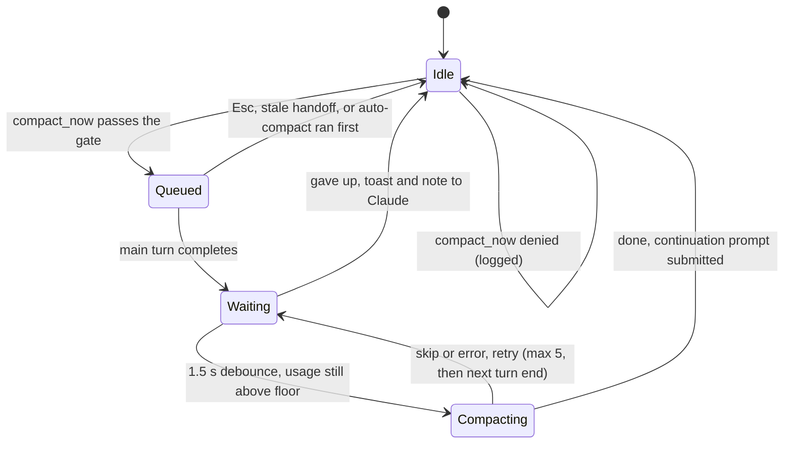

# Design

## Problem

Long Claude Code sessions compact whether you plan for it or not. Auto-compact fires at an arbitrary moment, often in the middle of a unit of work, and the summarizer has to guess which parts of the conversation matter. A manual `/compact` is better because a person picks the moment and writes the instructions, but it needs the person.

The design question is whether Claude can do the person's part: notice a good moment, write the instructions, and carry on afterwards. self-compact answers with a tool, a gate and a continuation prompt. It is a response to the feature requests [anthropics/claude-code#19877](https://github.com/anthropics/claude-code/issues/19877) and [#96713](https://github.com/anthropics/claude-code/issues/96713).

The node and anti-node lists below come from 214 manual compactions in one maintainer's own history (1M window, median 318k tokens before compaction). About a third of them happened at 32-72% of the window in the middle of a task, forced by context that had grown too big to ignore, with the task nowhere near a boundary. Claude is meant to catch that case earlier and at a cleaner point.

## Goals and non-goals

Goals:

1. Claude requests a compaction through a tool and writes the instructions itself.
2. The plugin reports real context usage, enforces a floor and nudges Claude to look for a node.
3. The compaction runs after the current turn, and Claude gets its next step back without the user pushing.
4. Standing orders, decisions with reasons, pending delegations and the user's recent wording survive.
5. Every request is logged so the thresholds can be tuned.

Non-goals:

- Replacing the summarizer or rewriting history. The plugin uses native compaction with instructions Claude wrote.
- Subagents. They stay short and are split when they grow; only the main session may compact.
- Other agent CLIs, external triggers, or cross-session compaction.

Failure modes that count as the plugin being wrong: more total tokens spent (compacting too early or too often), lower task quality (compacting at an anti-node, or a handoff that drops a rule), interrupting the user, and a session that stalls after compaction.

## Flow

```text
Claude judges it is at a node
  -> mcp__self-compact__compact_now(handoff)
       gate fails: return a denial with the current percentage and the floor
       gate passes: write handoff-<n>.md, queue the request, return "scheduled"
main turn completes (not aborted)
  -> 1.5 s debounce, re-read usage, still above the floor
  -> $.session.compact({ instructions })
       skipped or error: retry every 2 s, 5 times, once more at the next main turn end, then give up
       done: log, toast, $.prompt.submit(continuation)
```



One request is kept per session. A new `compact_now` replaces the queued one.

All per-conversation state (queue, baseline, counters, pending notes) is reset at `session.start` and again at `session.end`, because `/clear`, `/resume` and `/branch` fire no `session.start`.

## Gate

The plugin refuses the call unless both conditions hold:

1. `tokens >= floorPct% x window`
2. `tokens >= baseline + 20k + minSavingK x 1k`, where `baseline` is the context size of the session's first main request, taken only when the conversation has at most 3 messages so a resumed session does not inflate it (65k when unknown), 20k is the allowance for the summary and re-injected files, and `minSavingK` is the saving a compaction must still leave.

Both reduce to one threshold: `need = max(floorPct x window, baseline + 20k + minSavingK x 1k)`.

`tokens` comes from the engine's reading of the session's context (`$.session.usage()`), which is the usage on the newest assistant message. The Anthropic API sends the input counts in the stream's opening `message_start` event. Some Anthropic-compatible gateways send zeros there and the real counts only in the closing `message_delta`; OpenCode Go serving DeepSeek does this. The engine writes the corrected usage back when `message_delta` arrives, so the transcript and later turns are right, but a tool call made while the response is still streaming reads the zero snapshot and the engine reports no tokens. The gate then falls back to the total of the last main-loop request's usage, which the plugin reads on every `turn.step` anyway. That total trails the live context by one request (its output and tool results), so the fallback errs toward denying. A step reporting all-zero usage leaves the fallback unchanged. Any main-session compaction (the plugin's, auto-compact or `/compact`) replaces it with the compaction's reported size, or clears it when there is none, and session boundaries clear it, so a stale pre-compaction size never passes the gate.

With the defaults and a 65k baseline, `need = 125k`. On a 1M window that is 12.5%, so the 10% floor and the saving rule agree within 2.5 points. On a 200k window it is 62.5%, so small windows are no longer shut outright; in 0.2.0 the 55% post/pre ratio demanded 77% fill there.

Why an absolute saving: a compaction leaves about 21k behind (median `postTokens` over 83 compactions in the author's history). Compacting frees `tokens - 21k`, and the freeing has to pay for the summary. Stating that in tokens keeps the rule the same on every window size, which the earlier window-share ratio did not.

### Cost model

Relative to the input price: cache read 0.1x, 1-hour cache write 2x, output 5x. One compaction costs about `0.1 x C + 105k` input-equivalent tokens, where `C` is the context size and 105k is a conservative fixed estimate of generating the summary and re-caching. After it, each call saves `0.1 x (C - 20k)`, with 20k the measured median that remains.

| Context before | Cost of compacting | Saved per call | Break-even |
| --- | --- | --- | --- |
| 100k | 115k | 8k | about 14 calls |
| 150k | 120k | 13k | about 9 calls |
| 200k | 125k | 18k | about 7 calls |

A compaction takes 30-55 seconds on the measured setup. The model is an estimate; `log.jsonl` records before and after percentages so you can check it against your own sessions.

## Tiers

| Context | Behavior |
| --- | --- |
| below the floor | denied by the plugin |
| 10-15% | big phase handoffs only, with a clearly long next phase |
| 15% and up | any clean node |
| 20% and up | nudges start, then every 5% |
| 35% and up | nudge wording escalates: compact at the next safe step |

The tiers are in the tool description, so Claude sees them on every turn. Only the floor is enforced mechanically. The nudge start is `max(nudgeStartPct, floorPct)` so a nudge never appears below the floor.

## Nodes and anti-nodes

Good nodes, by frequency in the 214-compaction history:

1. A block of work ends: last tool was a commit-and-push check, merge confirmation, tests passing, sent message or ticket update; there is a completion summary; no agents are running. A main turn with two or more tool calls counts even without one of those tool signals, because that is the shape of most blocks in the history.
2. State was just written to disk (handoff file, memory, skill) and pushed.
3. Topic change: the user asks for something unrelated, or picks the work up after a pause.
4. Phase handoff: spec or plan written, next step named, merge request created.
5. A subagent returned, or work was delegated and now waiting, provided the handoff's `pending` lists each running task and how it reports back.
6. The user says to compact, continue or move on.

Anti-nodes, where compacting loses the most:

- A question is waiting for the user's answer.
- A draft is waiting for the user to say send.
- The user just corrected something or granted a permission that is not yet in the handoff.
- Mid polling, retrying, editing, or a debug loop.
- The API just returned an error.
- Waiting on a manual login or a dialog.
- A background agent's result arrived but has not been read.

The plugin checks one anti-node mechanically: the last tool call was `AskUserQuestion`. The rest is Claude's judgment, guided by the tool description.

## Handoff

`compact_now` takes `node`, `objective`, `standing_orders` (the user's rules in their own words), `decisions` (with reasons), `artifacts`, `pending` (each running task and how it reports), `done`, `next`, and optional `drop`. A call missing a required field is denied and the missing field is named.

The plugin renders the handoff as markdown, appends the user's last five real messages (commands, system reminders and task notifications are filtered out), writes `handoff-<n>.md`, and sends it as the compact instructions after a fixed preamble that tells the summarizer to keep standing orders verbatim, list every pending item and end with `next`.

Instructions are capped at 8,000 characters. Trimming order: `done`, then the oldest user messages, then `drop`, `decisions` and `artifacts` (from the end). `standing_orders`, `pending` and `next` are never trimmed.

## Races

| Situation | Behavior |
| --- | --- |
| The user types a new prompt while a request is queued | Compaction still runs after that turn. `next` is dropped and the continuation says only that the context was compacted. |
| Auto-compact ran first | The request is dropped, the continuation is still sent. |
| Esc on the turn, or during the compaction | The request is dropped, no continuation. Esc during the compaction is recognised by its abort, interrupt or cancel error text. |
| More than 3 other tool calls after queueing | The handoff is stale: dropped, and Claude is told to call again with current state. |
| A blocking Stop hook such as `/goal` keeps the turn open | The plugin ends the turn so the queued compaction can run. After one failed forced end it stops forcing until a natural turn end. Releasing is off by default because Claude Code's built-in guard (`cc-plugin-sec-default`) skips user mods' Stop hooks on Team/Enterprise logins and managed machines; `releaseStopHooks` helps only on personal setups. |
| The compact call is skipped or throws | Retry every 2 s up to 5 times, once more at the next main turn end, then give up with a toast and a note delivered to Claude on its next tool result or prompt. |
| Subagent, `-p`, SDK or cron session | Denied, no nudges. |

`compact_now` does not await the compaction. Calling compact from inside a running turn is refused by the engine, so the handler only checks the gate, writes the file, queues, and returns.

## Why the native summarizer

Two ways to shrink context exist: ask the built-in summarizer to do it with better instructions, or replace the history yourself with a summary written elsewhere. self-compact takes the first.

- The native path keeps everything Claude Code already does around compaction: re-injected files, hooks, session bookkeeping.
- Claude's handoff goes in as instructions, so the summary is written by a model that sees the whole conversation.
- No API key, no second model, no network call.

The cost is time: 30-55 seconds per compaction. If that becomes the limiting factor, replacing the history is the next step to evaluate; it is out of scope for 0.1.

Post-compact context is carried by the continuation prompt (standing orders and pending items verbatim). A `SessionStart` injection with `source: compact` was considered and left out: the continuation already carries both, and a second copy only adds tokens.

## Nudges

Each main-session step reads usage. Once usage passes the nudge start, and then after every further `nudgeStepPct`, one line with the current percentage is attached to the next text tool result, or to the next prompt's context if no text result comes first. Crossing `urgentPct` escalates immediately. Nudges stay silent while a request is queued or compacting, inside subagents, in non-interactive sessions and when the plugin is disabled. A missed nudge is acceptable: auto-compact is still the backstop above 35%.

## Autonomous triggers

A live test showed that the tool description alone never triggers a compaction: Claude finished phase one of a two-phase task and carried on. The user's requirement is that they never mention compaction, so the plugin supplies the trigger and Claude keeps the judgment. All three triggers sit behind `autoNodes`, share the normal gate, and never fire in subagents, non-interactive sessions, while a request is queued or compacting, or when the plugin is disabled.

**Node signals.** `detectNode(tool, input, result)` is a pure function over a finished main-session, non-error tool call. Strong: `git push`, `git merge`, PR/MR create, review, comment, close or merge, `gh issue comment`/`close`, `git tag`, an outbound message through `gog`, `agent-slack`, `slack` or `outlook` (`send`, `reply`, `post`), a write to a `specs/` or `plans/` markdown file or to a file named `HANDOFF*`/`handoff*`, a todo list whose items are all completed. Weak: `git commit`, a passing test command (`npm/pnpm/yarn/bun test`, `pytest`, `go test`, `cargo test`, `dotnet test`, `mvn`, `gradle`, `make test`/`check`), a new `.md` file, a background agent launch, a foreground subagent returning.

**Mid-turn flag.** When the gate passes, nothing is pending, and the signal is strong or the context is at least `floorPct + 5`, one line rides that tool's text result (the next prompt context otherwise). It names the node, states the context percentage and tells Claude to call `compact_now` before the turn ends if the phase is closed and no answer is awaited. One flag per turn.

**Turn-end self-check.** The fallback that makes the loop automatic. On a main `turn.complete` (not aborted, interactive, gate open, nothing pending) the plugin checks, in order, for a node signal this turn, for a turn that did real work (`WORK_TURN_MIN_CALLS = 2` main-session tool calls) with the context at or above `nudgeStartPct - 5`, or for a context at or above `nudgeStartPct` with no compaction. Only `AskUserQuestion` suppresses the check; a trailing `?` does not, because completion summaries often end with a question and the history shows compactions at exactly those points. A check is limited to one per trigger per 5 points of growth and never follows another check without tool activity in between. After the usual 1.5 s debounce and idle, the plugin submits one prompt: call `compact_now` if the phase is closed (`next` then states how to handle the user's latest message, or gives a one-line recap, when nothing continues by itself), otherwise answer "skip". The log records `self-check`, then `self-check:compacted` or `self-check:declined` for the following turn. `turnEndCheck=false` disables only this trigger.

**Block-start hint.** On any human prompt (composer or bridge) with the gate open and nothing pending, a model-only line suggests calling `compact_now` first when the message opens a new block of work (a different topic, or picking the work up after a pause) and the previous block is closed, with `next` carrying the gist of the new request. Gating this on a topic change alone missed the pause case: the history is full of `/compact` typed right after a block ended and before the next instruction.

Every successful compaction ends with the continuation prompt, whether it was requested at a phase end or in mid-conversation, so work always resumes.

## Data

`~/.claude/self-compact/<session-id>/handoff-<n>.md` and `~/.claude/self-compact/log.jsonl`. Mods cannot import `node:fs`, so files go through the engine's `$.fs`. Nothing leaves the machine and the plugin makes no network calls.

Past about 2 MB, `log.jsonl` is moved to `log.1.jsonl` and a new file starts. A log that cannot be read is left untouched rather than overwritten.

`log.jsonl` has one JSON line per request: `ts`, `session`, `node`, `pct` (usage at request), `result` (`queued`, `denied:<why>`, `done`, `preempted`, `aborted`, `stale`, `failed`, `error`), an optional `reason`, `beforePct`, `afterPct` and `durationMs`.

## Language

Everything the user or the model reads comes from one table in `register.ts`, keyed by the `language` option: `en` (default) or `zh`; any other value is `en`. That covers the tool description and its field descriptions, denial reasons, the scheduled result, the stale note, nudges, status line, toasts, failure note, the compact-instruction preamble, the handoff section headings and the continuation prompt. User-supplied handoff content is never translated.

## Acknowledgements

The design takes ideas from earlier community work and copies no code: the gate-plus-judgment split, post-turn execution, re-check before compacting and Stop-hook release (self-compact by StevenLi-phoenix); fixed handoff sections, verbatim user wording and nudges on tool results (forward-compaction by rezzminator); asking once per threshold (polite-compaction by dtinth). The implementation is a clean-room rewrite.
